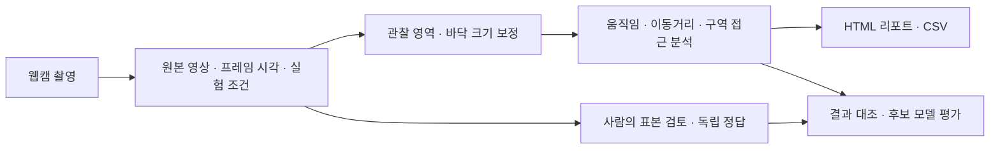
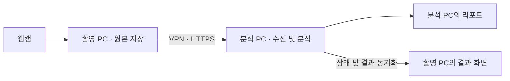

# BehavTrack

웹캠으로 설치류를 촬영하고, 움직임과 구역 접근을 분석해 HTML 리포트와 CSV로 정리하는 Windows 연구 도구입니다. 브라우저에서 촬영·분석·수동 검토를 진행합니다.

촬영 파일에 실험 조건과 실제 프레임 시각을 연결하고, 같은 원본에서 분석·검토 이력을 쌓을 수 있도록 만들었습니다. 한 대의 PC에서 시작하거나, 별도의 촬영 PC가 분석 서버로 영상을 전송하는 구성으로 사용할 수 있습니다.

**현재 공개 버전은 v0.2.0입니다.** 기본 촬영과 명암 기반 이동거리 분석은 CPU에서 실행됩니다. DeepLabCut 기반 분석은 별도의 환경과 모델을 준비해 사용합니다.

[데모 리포트 다운로드](https://github.com/jjminu/behavtrack-research/releases/download/v0.2.0/behavtrack-demo.html) · [릴리스](https://github.com/jjminu/behavtrack-research/releases/tag/v0.2.0) · [Windows 사용 안내](윈도우_사용설명서.md)


위 그래프는 합성 대상 두 개의 이동을 분석한 결과입니다. 전반 4초에는 2.5 cm/s, 후반 4초에는 5 cm/s로 움직이도록 만든 영상에서 거리·속도 계산과 리포트 생성을 확인합니다.

## 목차

- [주요 기능](#주요-기능)
- [설치 및 실행](#설치-및-실행)
- [카메라 없이 실행하는 합성 데모](#카메라-없이-실행하는-합성-데모)
- [첫 촬영부터 리포트까지](#첫-촬영부터-리포트까지)
- [원격 촬영 PC와 분석 서버](#원격-촬영-pc와-분석-서버)
- [결과 해석](#결과-해석)
- [결과 파일과 저장 위치](#결과-파일과-저장-위치)
- [검증 범위](#검증-범위)
- [문제 해결](#문제-해결)
- [개발 및 테스트](#개발-및-테스트)

## 주요 기능

| 기능 | 제공하는 작업과 결과 | 준비 사항 |
| --- | --- | --- |
| 로컬 촬영 | 카메라 미리보기, 기본 10분 단위 영상 저장, 프레임별 촬영 시각과 관찰 조건 기록 | 기본 설치, 연결된 카메라 |
| 이동거리·평균 속도 | 바닥 네 모서리와 실측 길이로 보정한 중심점 이동 추정, 추적 확인 영상, HTML·CSV | 상부 고정 촬영, 실측 바닥 크기, 명암 분리 또는 DeepLabCut 검출 |
| 케이지 활동성 | 프레임 사이 픽셀 변화에 따른 영상 움직임 지수, 시간대별 요약 | 기본 설치, 관찰 영역과 분석 간격 |
| 사료 구역 접근 | 몸 중심이 지정 구역에 포함된 마릿수와 유효 표본 대비 접근 관측 비율 | 브라우저 자동 분석에는 DeepLabCut 검출 모델 |
| 그룹 비교 | 동일 조건의 케이지별 결과와 그룹 평균·표준편차, 비교 제외 사유 | 케이지·그룹·촬영 설정·비교 블록 지정 |
| 원격 촬영 | 별도 PC의 미리보기, 원본 전송, 분석 진행률과 결과 동기화 | VPN, 분석 서버의 `server` 추가 의존성 |
| 수동 검토와 평가 | 표본별 사람의 판정, 독립 정답 고정, 연구 사건·수정 이력 기록 | 검토자 코드와 직접 작성한 정답 |
| 포즈·행동 분류 확장 | DeepLabCut CSV·SLEAP HDF5 가져오기, 행동 라벨 기반 분류기 학습·평가 | 외부 포즈, 행동 라벨, `pose`·`classify` 추가 의존성 |



## 설치 및 실행

### 준비 환경

| 항목 | 기준 |
| --- | --- |
| 운영체제 | Windows 64비트. 공개본 설치 검증 환경은 Windows + Python 3.11.9 |
| Python | Python 3.11 64비트 권장 |
| 카메라 | OpenCV에서 열 수 있는 웹캠. 합성 데모는 카메라 없이 실행 가능 |
| 저장 공간 | 원본 녹화 영상과 분석 결과를 저장할 공간 |
| 인터넷 | 최초 패키지 설치와 선택 모델 다운로드 때 사용 |
| GPU | 기본 촬영·합성 데모·명암 기반 이동거리 분석은 CPU로 실행 |

### 소스 받기

저장소의 **Code → Download ZIP**을 눌러 압축을 완전히 푼 뒤, `pyproject.toml`이 있는 폴더에서 PowerShell을 여세요. Git을 사용하는 경우 다음 명령으로 받을 수 있습니다.

```powershell
git clone https://github.com/jjminu/behavtrack-research.git
cd behavtrack-research
```

### 기본 설치

```powershell
py -3.11 -m venv .venv
.\.venv\Scripts\python.exe -m pip install -e .
```

### 프로그램 시작

```powershell
.\.venv\Scripts\python.exe -m behavtrack.research_web
```

브라우저에 연구 화면이 열립니다. 브라우저와 카메라를 처리하는 Python 프로그램이 함께 동작하므로, 종료할 때는 화면 오른쪽 위의 **프로그램 종료**를 사용하세요. 브라우저 창을 닫은 뒤에도 녹화가 계속될 수 있습니다.

명령에서는 가상환경의 Python을 직접 지정합니다. 이후 실행할 때도 같은 폴더에서 위 시작 명령을 사용하면 됩니다.

### 선택 기능 설치

| 필요한 기능 | 프로젝트 폴더에서 실행할 PowerShell 명령 |
| --- | --- |
| 원격 촬영 수신 서버 | `.\.venv\Scripts\python.exe -m pip install -e ".[server]"` |
| SLEAP HDF5 포즈 가져오기 | `.\.venv\Scripts\python.exe -m pip install -e ".[pose]"` |
| 행동 분류기 학습·평가 | `.\.venv\Scripts\python.exe -m pip install -e ".[classify]"` |
| 개발·전체 테스트 의존성 | `.\.venv\Scripts\python.exe -m pip install -e ".[dev,pose,classify,server]"` |

DeepLabCut 기반 검출에는 `.ai_venv` 환경과 해당 모델 가중치가 필요합니다. 준비 경로와 외부 모델의 이용 조건은 모델 안내에 정리되어 있습니다. [선택 기능용 모델 안내](models/README.md)

## 카메라 없이 실행하는 합성 데모

기본 설치 후 아래 명령을 실행하세요. 160 × 120 픽셀 영상에 밝은 원 두 개를 그려 8초 동안 이동시키고, 바닥을 40 × 30 cm로 보정해 실제 분석 경로로 처리합니다.

```powershell
.\.venv\Scripts\python.exe examples\synthetic_locomotion.py
```

`demo-output/report.html`을 브라우저로 열면 됩니다. 실행이 끝나면 콘솔에도 계산 결과와 리포트 경로가 표시됩니다.

```text
60.000 cm · 3.750 cm/s · 100.0% coverage
```

| 지표 | 합성 영상 기준값 | 공개 데모 결과 |
| --- | ---: | ---: |
| 두 대상의 이동거리 합계 | 60 cm | 60.000 cm |
| 대상당 환산 이동거리 | 30 cm | 30.000 cm |
| 대상당 평균 속도 | 3.75 cm/s | 3.750 cm/s |
| 유효 추적 시간 | 8초 | 8초 |
| 유효 추적 비율 | 100% | 100% |

데모 스크립트는 영상 생성 → 프레임 시각 기록 → 명암 기반 검출 → 거리 계산 → 기준값 대조 → HTML·그래프 저장을 실행합니다. 최종 출력은 `report.html`과 `chart.png`이며, 생성 과정의 임시 영상은 처리 후 정리됩니다. 저장 위치는 `--output`으로 지정할 수 있습니다.

```powershell
.\.venv\Scripts\python.exe examples\synthetic_locomotion.py --output demo-output\example
```

설치 전에도 완성된 HTML 파일을 내려받아 브라우저로 열어볼 수 있습니다. [데모 리포트 다운로드](https://github.com/jjminu/behavtrack-research/releases/download/v0.2.0/behavtrack-demo.html) · [리포트 원본](docs/demo/report.html) · [데모 생성 코드](examples/synthetic_locomotion.py)

## 첫 촬영부터 리포트까지

1. **촬영 조건을 입력합니다.** `촬영하기`에서 카메라를 켜고 그룹 이름, 케이지 ID, 마릿수와 처치 조건을 확인합니다. 영상에서 사료 주변 관찰 영역을 드래그해 지정합니다.
2. **영상을 기록합니다.** `녹화 시작`을 누르면 관찰 조건이 고정됩니다. 종료하면 원본 영상과 프레임 시각이 하나의 촬영 세션에 저장됩니다. 긴 영상은 기본 10분 단위로 나뉩니다.
3. **이동거리 분석을 설정합니다.** `이동거리·속도 · 그룹 비교`에서 촬영 원본을 선택합니다. 고정된 상부 촬영 영상에 바닥 네 모서리를 왼쪽 위부터 시계 방향으로 표시하고, 실측 가로·세로 길이를 입력합니다.
4. **검출 방식과 간격을 정합니다.** 어두운 고정 배경의 밝은 마우스에는 명암 분리 방식을 사용할 수 있습니다. 밝기 기준과 추적 간격을 지정하고 분석을 시작합니다. DeepLabCut 방식을 선택하면 준비한 검출 모델을 사용합니다.
5. **계산 결과와 추적 영상을 확인합니다.** 거리·속도와 함께 유효 추적 비율, 판정 불가 사유, 추적 확인 영상을 봅니다. 반사나 벽이 검출되는지, 마우스가 겹치는 구간이 어떻게 처리되는지 확인합니다.
6. **조건을 맞춰 비교합니다.** 그룹, 케이지 ID, 촬영 설정 ID와 비교 블록을 지정한 결과를 선택합니다. 동일 케이지의 반복 촬영은 케이지 단위로 집계됩니다.

사료 구역 접근은 `결과 · 검토`, 영상 픽셀 변화에 따른 활동성은 `케이지 활동성 · 물 비교`에서 확인합니다. 직접 작성한 정답과 분석 결과를 대조하려면 `독립 정답 · 사건`과 `자료 점검 · 학습 · 평가`를 사용하세요. 독립 평가 자료는 AI 결과를 보기 전에 정답을 고정하는 흐름을 제공합니다.

## 원격 촬영 PC와 분석 서버

촬영 PC는 원본을 로컬에 저장한 뒤 분석 PC로 전송합니다. 분석 PC가 결과를 계산하면 양쪽 화면에서 상태와 결과를 확인할 수 있습니다.



1. 두 PC에 기본 설치를 진행하고 같은 Tailscale 또는 기관 VPN에 연결합니다.
2. 분석 PC에 `server` 의존성을 설치하고 연구 화면을 실행합니다.

   ```powershell
   .\.venv\Scripts\python.exe -m pip install -e ".[server]"
   .\.venv\Scripts\python.exe -m behavtrack.research_web
   ```

3. `원격 촬영 · 분석 서버`에서 분석 PC의 VPN IPv4 주소와 수신 포트를 지정해 서버를 시작합니다. 기본 수신 포트는 `8877`이며, Windows 방화벽에서 VPN을 통한 접근을 허용합니다.
4. 촬영 장치 연결 파일을 발급해 촬영 PC의 프로젝트 폴더에 `capture_connection.json`으로 저장하거나 촬영 화면에 등록합니다.
5. 촬영 PC에서 다음 명령을 실행한 뒤 연결 상태와 카메라를 확인합니다.

   ```powershell
   .\.venv\Scripts\python.exe -m behavtrack.capture_agent
   ```

연결 파일에는 장치별 인증 정보가 들어 있습니다. 분석 서버의 관리 화면은 해당 PC의 로컬 주소에서 열리며, 촬영 PC는 발급받은 연결 정보로 원본 전송과 결과 조회를 수행합니다. 연결 절차와 저장 위치는 Windows 안내에서도 확인할 수 있습니다. [Windows 사용 안내](윈도우_사용설명서.md)

## 결과 해석

### 지표의 정의

| 지표 | 계산과 의미 |
| --- | --- |
| 유효 구간 전체 이동거리 | 모든 마우스를 검출하고 인접 표본의 위치를 연결할 수 있는 구간에서 중심점 이동거리를 합산한 값 |
| 마리당 환산 이동거리 | 유효 구간 전체 이동거리 ÷ 마릿수 |
| 마리당 평균 속도 | 유효 구간 전체 이동거리 ÷ (마릿수 × 유효 추적 시간) |
| 유효 추적 비율 | 유효 추적 시간 ÷ 분석 관찰 시간 × 100 |
| 영상 움직임 지수 | 관찰 영역에서 프레임 사이 변화한 픽셀의 비율을 바탕으로 한 활동성 추정 |
| 사료 구역 접근 관측 비율 | 판정 가능한 표본 중 한 마리 이상 몸 중심이 지정 구역에 포함된 표본의 비율 |

겹침, 검출 누락, 위치 연결의 불확실성은 판정 불가로 기록합니다. 거리·속도의 분모에는 유효하게 추적한 시간만 사용합니다. **추적 비율과 판정 불가 사유를 거리·속도와 함께 확인해야 합니다.**

### 비교할 때 확인할 조건

- 바닥 크기 보정, 카메라 구도, 마릿수, 추적 간격, 관찰 길이와 분석 설정을 맞춥니다.
- 같은 조건의 촬영에는 같은 촬영 설정 ID와 비교 블록을 부여합니다. 투여 방식과 그룹 정보를 확인합니다.
- 이동거리 비교는 cm 보정이 완료되고 유효 추적 비율이 80% 이상인 결과를 대상으로 합니다. 이 기준은 소프트웨어의 누락 제한 기준입니다.
- 같은 케이지의 반복 촬영은 한 케이지 값으로 합쳐 집계합니다. 그룹 요약은 케이지 수, 평균과 표준편차를 제공합니다.

### 측정 범위

이동거리는 영상 평면에서 표본화한 몸 중심점의 경로 추정치입니다. 표본 사이의 굽은 경로, 가림, 검출 흔들림과 몸 높이가 오차에 영향을 줍니다. 바닥 네 모서리 보정은 바닥 평면의 원근을 보정하며, 렌즈 왜곡·일어서기·등반의 영향은 별도로 고려해야 합니다.

공동 사육 이동거리의 마리당 값은 케이지 합계를 마릿수로 환산한 값입니다. 개체별 연속 식별과 행동 판정에는 별도의 포즈·라벨 및 검증이 필요합니다. 사료 주변 접근 지표를 섭취량이나 실제 섭식으로 해석하려면 독립적인 측정 자료와 대조해야 합니다.

그룹 비교 결과는 기술적 요약입니다. 처치 효과의 판단에는 실험 설계, 누락 편향과 별도의 통계 분석을 고려해야 합니다.

## 결과 파일과 저장 위치

로컬 촬영과 분석 결과는 프로젝트의 `results/`, 촬영 전용 PC의 원본은 `capture_results/`에 저장됩니다. 세션 폴더의 핵심 파일은 다음과 같습니다.

| 파일 | 내용 |
| --- | --- |
| `raw.mp4`, `raw_000001.mp4` 등 | 순서대로 이어지는 원본 녹화 조각 |
| `frame_times.csv` | 전체 프레임 번호, 조각 내 프레임 번호와 촬영 시각 |
| `protocol.json` | 촬영 시작 시 고정한 관찰 조건 |
| `recording.json` | 녹화 상태, 영상 조각, 프레임 수와 무결성 정보 |

이동거리 분석 결과는 해당 세션의 `locomotion/loco_.../`에 저장됩니다.

| 파일 | 내용 |
| --- | --- |
| `report.html` | 브라우저에서 열 수 있는 결과 리포트 |
| `chart.png` | 시간대별 평균 속도와 유효 추적 비율 |
| `pairs.csv` | 인접 표본별 시간, 이동거리, 유효 여부와 판정 사유 |
| `tracking.mp4` | 검출과 연결 상태를 확인하는 영상 |
| `locomotion.json` | 요약값, 분석 설정, 코드·입력·결과 파일의 해시 |

세션을 다른 PC로 옮기거나 보관할 때는 원본 영상과 JSON·CSV를 함께 보관하세요. 촬영 시각과 조건, 원본 파일의 대응 관계를 재분석에 사용합니다.

## 검증 범위

v0.2.0 공개 시 Windows의 새 Python 3.11.9 환경에서 설치와 합성 데모 재생성을 확인했습니다. 당시 자동 테스트 결과는 **150개 통과, 1개 건너뜀**입니다.

테스트에는 알려진 합성 이동거리, 보정 좌표, 가림·결측 처리, 영상 조각과 촬영 시각 연결, 원격 전송 재개, 인증 범위, 케이지 단위 비교 등이 포함됩니다. 데모는 명암 기반 검출과 거리 계산의 재현 예제입니다.

실제 카메라·조명·동물 조건의 정확도와 장시간 촬영 안정성은 해당 환경에서 추가 검증이 필요합니다. 연구에 적용할 때는 사람이 독립적으로 채점한 좌표·행동과 비교해 오차와 판정 불가 비율을 확인하세요. 공개 데이터로 수행했던 별도 행동 분류 평가와 검증 절차는 아래 문서에 있습니다. [실험 검증 기준](실험_검증_기준.md)

## 문제 해결

| 증상 | 확인할 내용 |
| --- | --- |
| `py` 명령을 찾을 수 없음 | Python 3.11 64비트와 Python Launcher 설치 여부를 확인하고 PowerShell을 다시 엽니다. |
| `No module named behavtrack` 또는 패키지 오류 | `pyproject.toml`이 있는 폴더에서 `.\.venv\Scripts\python.exe -m pip install -e .`를 실행하고 같은 Python으로 시작합니다. |
| 카메라가 열리지 않음 | Windows의 카메라 접근 권한, USB 연결, 화면의 카메라 번호를 확인합니다. 다른 카메라 사용 앱을 종료한 뒤 다시 시도합니다. |
| 브라우저가 자동으로 열리지 않음 | 실행 터미널에 표시된 로컬 연구 화면 주소를 브라우저에서 엽니다. 주소에는 해당 실행의 접근 토큰이 포함됩니다. |
| AI 모델 준비 오류 | `.ai_venv`와 모델 파일 경로를 모델 안내에 따라 확인합니다. 기본 설치만 완료한 경우에는 명암 기반 이동거리와 합성 데모부터 실행할 수 있습니다. |
| cm 결과를 계산할 수 없음 | 바닥 네 모서리의 순서, 실측 가로·세로 길이, 상부 촬영 조건을 확인합니다. |
| 유효 추적 비율이 낮음 | 추적 확인 영상에서 겹침·반사·마릿수·명암 기준을 확인합니다. 유효 구간과 판정 불가 구간의 차이도 함께 검토합니다. |
| 원격 연결 또는 전송 실패 | 양쪽 VPN 연결, 분석 서버의 수신 상태, 주소·포트, 방화벽과 장치 연결 파일을 확인합니다. |

추가 문제가 있으면 운영체제, Python 버전, 실행 명령과 오류 메시지를 이슈에 남겨 주세요. 재현 예시는 합성 자료로 작성하고, 오류 메시지의 로컬 경로와 접근 토큰을 제거해 주세요. [GitHub Issues](https://github.com/jjminu/behavtrack-research/issues)

## 개발 및 테스트

```powershell
.\.venv\Scripts\python.exe -m pip install -e ".[dev,pose,classify,server]"
.\.venv\Scripts\python.exe -m pytest
```

주요 명령의 인자와 사용법은 `--help`로 확인할 수 있습니다.

```powershell
.\.venv\Scripts\python.exe -m behavtrack --help
.\.venv\Scripts\python.exe -m behavtrack.research_cli --help
.\.venv\Scripts\python.exe -m behavtrack.capture_agent --help
```

| 경로 | 역할 |
| --- | --- |
| `behavtrack/web/` | 브라우저 화면과 JavaScript |
| `behavtrack/research_web.py` | 로컬 연구 화면과 API |
| `behavtrack/recording_io.py` | 영상 조각·프레임 시각·세션 복구 |
| `behavtrack/cage_locomotion.py` | 중심점 연결, 이동거리·속도와 리포트 |
| `behavtrack/cage_activity.py` | 영상 움직임 지수와 케이지 비교 |
| `behavtrack/capture_agent.py`, `behavtrack/remote_service.py` | 촬영 PC와 분석 서버 사이의 전송·동기화 |
| `behavtrack/ml_workflow.py`, `behavtrack/evaluation.py` | 학습 자료 점검과 후보 모델 평가 |
| `examples/synthetic_locomotion.py` | 카메라 없이 실행하는 이동거리 데모 |
| `tests/` | 합성 자료와 모의 장치를 이용한 회귀 테스트 |

기본 분석은 OpenCV·NumPy·Matplotlib, 선택 기능은 scikit-learn·h5py·cryptography를 사용합니다. 의존성 목록과 명령 진입점은 프로젝트 설정에서 확인할 수 있습니다. [pyproject.toml](pyproject.toml)

변경 사항을 제안할 때는 재현 조건, 기대한 결과와 실제 결과를 함께 설명해 주세요. 모델을 이용하거나 재배포할 때 적용되는 외부 라이선스와 출처는 모델 폴더에 정리되어 있습니다. [모델 안내와 이용 조건](models/README.md)
