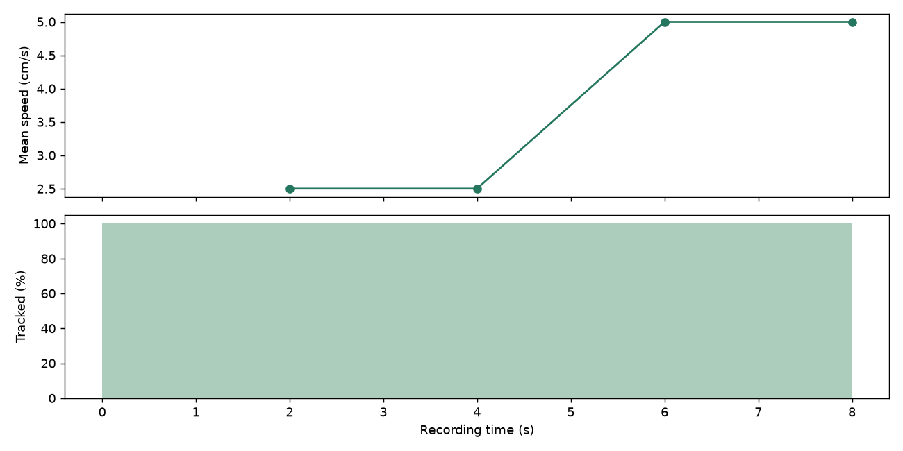

# BehavTrack

웹캠으로 설치류를 촬영하고, 움직임과 구역 접근을 분석해 HTML 리포트와 CSV로 정리하는 Windows 연구 도구입니다. 브라우저에서 촬영·분석·수동 검토를 진행합니다.

- **촬영 및 전송** — 로컬 녹화, 촬영 시각 기록, 별도 촬영 PC의 원격 미리보기와 HTTPS 전송
- **이동거리 및 속도** — 바닥의 네 모서리와 실측 길이로 보정해 추적 가능한 구간의 이동거리와 평균 속도 추정
- **케이지 단위 분석** — 영상 픽셀 변화에 따른 활동성 지수, 사료 구역 접근 추정, 조건별 기술적 비교
- **연구 기록** — 분석 설정과 결과 이력, 수동 표본 검토, 외부 포즈 자료 가져오기

## 설치 및 실행

Windows 64비트와 Python 3.11을 사용합니다. 저장소의 **Code → Download ZIP**으로 받은 파일의 압축을 푼 뒤, 해당 폴더에서 PowerShell을 여세요. 처음 설치할 때 인터넷 연결이 필요합니다.

```powershell
py -3.11 -m venv .venv
.\.venv\Scripts\python.exe -m pip install -e .
.\.venv\Scripts\python.exe -m behavtrack.research_web
```

브라우저가 열리면 카메라를 연결해 촬영을 시작하거나, 아래 합성 데모를 실행해 보세요. 원격 촬영 PC 연결과 선택 기능은 [Windows 사용 안내](윈도우_사용설명서.md)를 참고하세요.

## 카메라 없이 실행하는 합성 데모

밝은 원 두 개가 알려진 거리만큼 움직이는 8초짜리 영상을 생성합니다. 프로그램의 명암 기반 검출, 바닥 보정, 거리·속도 분석을 거쳐 리포트를 만듭니다.

```powershell
.\.venv\Scripts\python.exe examples\synthetic_locomotion.py
```

`demo-output/report.html`을 브라우저로 열면 됩니다. 실행 예시는 [데모 리포트 다운로드](https://github.com/jjminu/behavtrack-research/releases/download/v0.2.0/behavtrack-demo.html)에서 받을 수 있습니다. [저장소의 HTML 파일](docs/demo/report.html)에도 같은 내용이 있습니다.

| 지표 | 합성 영상 기준값 |
| --- | ---: |
| 두 대상의 이동거리 합계 | 60 cm |
| 대상당 평균 속도 | 3.75 cm/s |
| 유효 추적 시간 | 8초 / 8초 |



## 결과 해석

이동거리와 평균 속도는 모든 대상이 검출되고 위치를 연결할 수 있는 구간에서 계산합니다. 마리당 환산 이동거리는 전체 이동거리 합계를 마릿수로 나눈 값입니다. 사료 구역 접근은 지정한 구역에 대한 위치 기반 추정치입니다. 합성 데모는 계산 경로를 확인하는 예제이며, 실제 실험 환경의 추적·행동 분류 정확도는 독립 수동 채점과 비교해 확인해야 합니다.

## 개발 및 테스트

```powershell
.\.venv\Scripts\python.exe -m pip install -e ".[dev,pose,classify,server]"
.\.venv\Scripts\python.exe -m pytest
```
